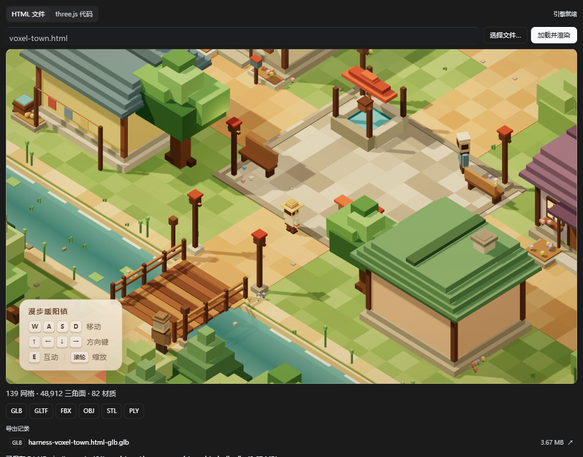
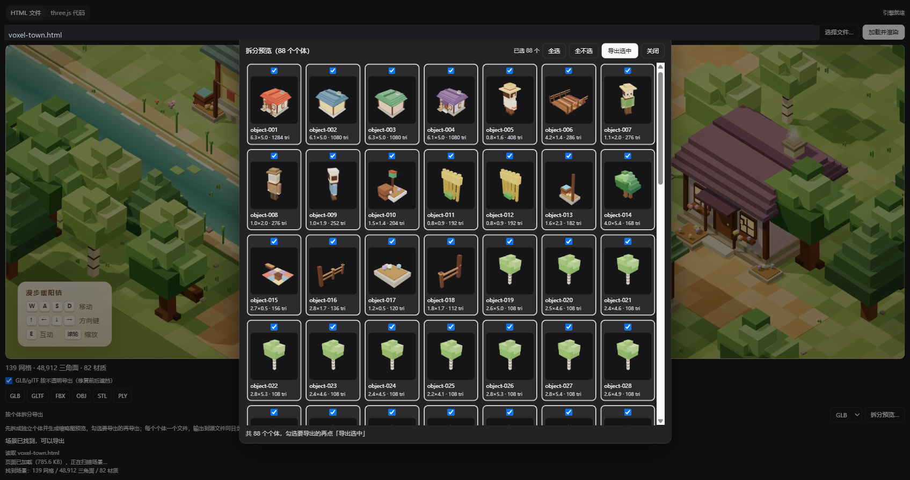
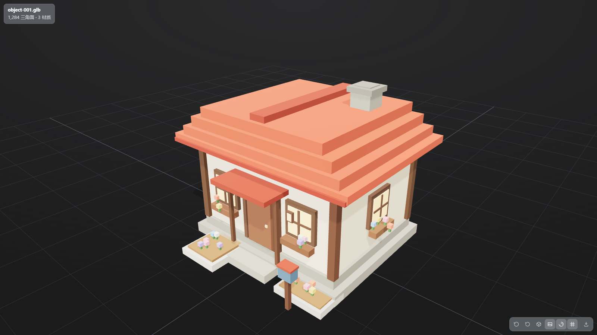

# dsh-3d-model-studio

[中文](README.md) | English

A [DeepSeek Harness](https://github.com/deepseek-ai/deepseek-harness) plugin that previews 3D models and parses **three.js scenes** into **GLB, glTF, FBX, OBJ, STL and PLY**, with both **full-scene export** and **per-object grouped export**. It previews/converts existing model files and also loads runtime-built three.js scenes from an HTML page or pasted code.

It is the DSH packaging of `three-export-kit`, merged with the full preview capability of `dsh-3d-model-preview`.

## Features

- **Preview** — open `.glb .gltf .stl .ply .obj .fbx` from the sidebar; PBR materials, 15 texture slots, animation clips, auto framing, wireframe/normal/ground-grid toggles.
- **Export from the preview** — GLB / glTF / FBX / OBJ / STL / PLY of the loaded scene (textures and animation preserved). Writes next to the source model, or falls back to a browser download.
- **Scene export page** — load an HTML page that builds a three.js scene at runtime (or paste three.js code), scan it, then export the scene as a model. Includes an **opaque export** switch that fixes glTF BLEND depth-order artifacts.
- **Full-scene export** — export the whole `THREE.Scene` as one GLB/glTF/FBX/OBJ/STL/PLY file, preserving meshes, materials, textures and transforms.
- **Grouped export** — split the scene into individual objects (buildings, trees, bridge, villagers, props), show a thumbnail for each, tick the ones you want and export each as a separate file under `split-export/`.
- **Agent tool `three_export`** — convert or inspect models by path from an agent session.

## three.js scene parsing: full export and grouped export

This is not just a model-file viewer: it parses **runtime-built three.js scenes** and supports two export granularities.

| Mode | What it does | Output |
|---|---|---|
| **Full export** | Export the whole `THREE.Scene` in one pass, keeping meshes, materials, textures and transforms | One GLB / glTF / FBX / OBJ / STL / PLY file |
| **Grouped export** | Split the scene into individual objects by geometry connectivity and bounding-box relationships (buildings, trees, bridge, villagers, props), preview thumbnails, then tick what to export | One file per object, written to `split-export/` |

Parsing sources:

- **HTML file** — loads the page in a same-origin iframe, runs its scripts, scans `window` for a reachable `THREE.Scene`, and reports mesh / triangle / material counts.
- **three.js code** — paste code, run it in the page, scan the resulting scene; useful for procedural scenes.
- Handles `Group` nodes, multi-material meshes, textures and transforms; lights, fog and background are stripped before export (model files only carry geometry + materials).

Grouped split strategy (tested):

- Existing `Group` objects (trees, villagers, props) become one object directly.
- Large meshes merged by material (buildings, bridge, plaza props) are split by index connectivity into boxes, then merged by AABB intersection/touching.
- Roofs/windows contained by a building's bounding box are folded back into the building; bridge deck/rail parts with nearly identical bounds are merged.
- Terrain (ground, river, roads) and tiny decorations (flowers, grass, stones) are skipped; only main subjects are exported.
- voxel-town test: 139 meshes / 48,912 triangles → **88 objects**; selecting 83 exported 83 files.

### Screenshots



*Full export: 139 meshes / 48,912 triangles / 82 materials parsed; GLB exported at 3.67 MB, with an export record that can be reopened in the preview.*



*Grouped preview: 88 objects, each with an auto-rendered thumbnail, dimensions and triangle count; all selected by default, individually toggleable.*



*Preview window: opening the exported `object-001.glb` (1,284 triangles / 3 materials) with auto framing, PBR materials, and the bottom toolbar (reset view, auto-rotate, wireframe, textures, normals, ground grid, animation, export).*

## Install

```powershell
# from npm
plugin_manager action=install_bundle target="dsh-3d-model-studio"

# or from this Git repository
plugin_manager action=install_bundle target="https://github.com/act27/dsh-3d-model-studio"
```

Local development build:

```powershell
pwsh -NoProfile -File .\scripts\install.ps1
# then install dist\dsh-3d-model-studio-0.3.1.tgz with plugin_manager
```

## Usage

- Open a model file in the right sidebar → preview and use the **Export** menu in the bottom-right toolbar.
- Open the **Scene export** page in the right sidebar to load a local HTML page or paste three.js code, then export the scene.
- Click **Split preview…** to split the scene into objects, select the ones to export, and write them to `split-export/` next to the source file.

## Security

The scene export page loads the selected HTML in a **same-origin iframe**, so page scripts run with GUI privileges. Only load HTML files you trust. `/api/dsh-3d-model-studio/*` routes are behind the owner-cookie admission check, but the page script itself is not sandboxed from the GUI.

## Limitations

- Scene export is a static snapshot: animation, skinning, lights, cameras, fog and background are not exported; lines/points/sprites are skipped; `ShaderMaterial` degrades to a standard material.
- Split export is heuristic: it groups by geometry adjacency and bounding-box containment/overlap, not semantic names. Adjacent objects can merge or one object can split into two; output files are named `object-NNN`.
- No Draco / KTX2 compressed glTF support.
- `.obj` uses only the first MTL; `.fbx` external textures are matched by filename in the same directory.

## Development

```powershell
npm install
node tests/plugin.test.mjs
node tests/client.test.mjs
node scripts/verify-chunk.mjs
pwsh -NoProfile -File .\scripts\preflight.ps1
```

The client three.js engine chunk (`client/client.three.js`) is generated by `node scripts/build-engine.mjs`; exporter and viewer must share the same chunk.

## License

MIT. See [LICENSE](LICENSE) and [THIRD-PARTY-NOTICES.md](THIRD-PARTY-NOTICES.md).
