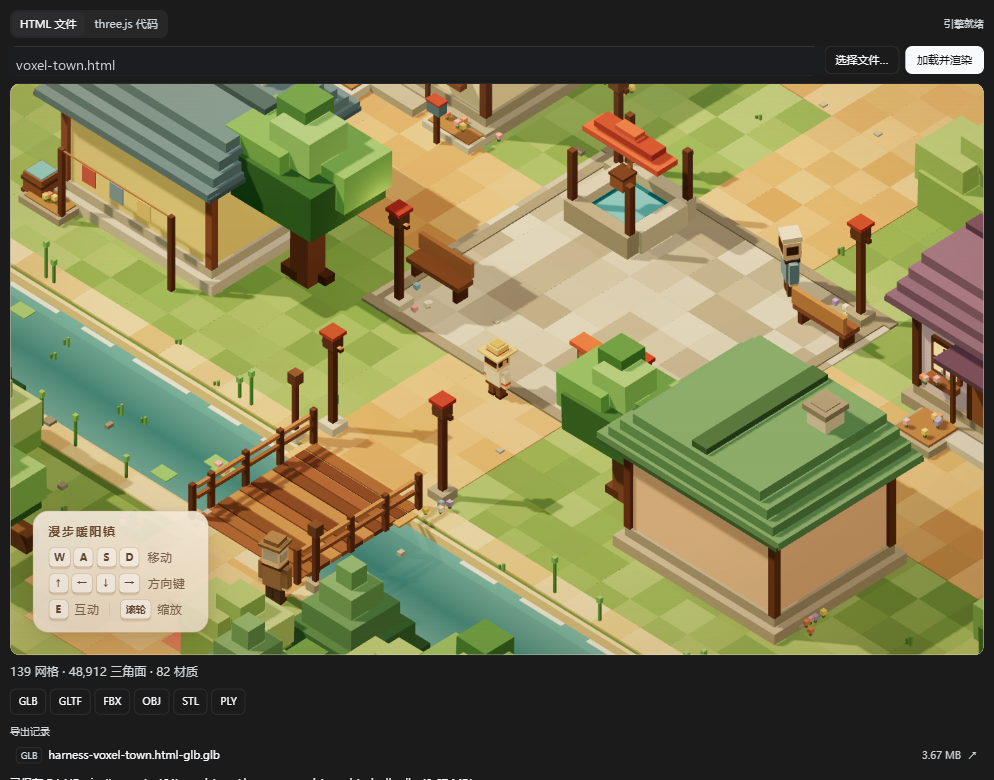
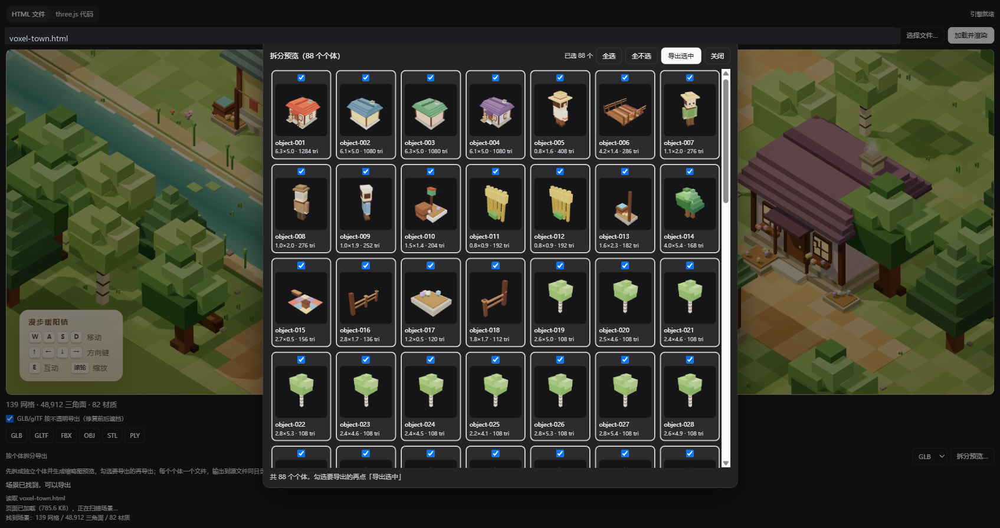
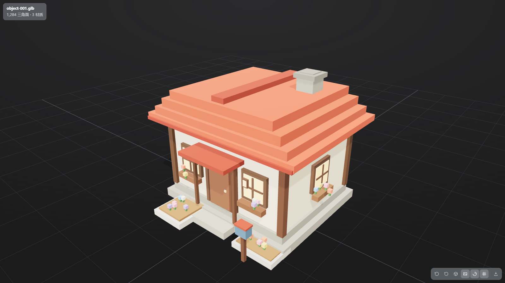

# dsh-3d-model-studio

[English](README.en.md) | 中文

在 DeepSeek Harness 右侧栏预览 3D 模型，并把 **three.js 场景**解析导出为 GLB / glTF / FBX /
OBJ / STL / PLY，支持**完整导出**和**按个体分组导出**两种粒度。它既能直接预览/转换已有的
模型文件，也能加载运行时构建的 three.js 场景（HTML 页面或粘贴代码）。它是 `three-export-kit`
的 DSH 插件化版本，包含完整的 3D 模型预览与导出能力。

## 一、能力

| 能力 | 入口 | 说明 |
|---|---|---|
| 预览 | 右侧栏「文件」页打开模型 | `.glb .gltf .stl .ply .obj .fbx`；PBR 材质、15 个贴图槽位、多剪辑动画、自适应取景 |
| 预览工具栏导出 | 预览右下角「导出」按钮 | GLB / glTF / FBX / OBJ / STL / PLY，导出**当前已加载的场景**（贴图、动画都在） |
| 导出落盘 | 同一按钮 | 优先由宿主写到**模型同目录**（`<名字>.<新后缀>`，同名自动 `-1`），失败自动改为浏览器下载 |
| **场景导出页** | 右侧栏「场景导出」页 | 把 **HTML 页面**或**粘贴的 three.js 代码**里的场景渲染出来，再导出成模型文件（GLB/glTF/FBX/OBJ/STL/PLY） |
| **three.js 完整导出** | 场景导出页 → 格式按钮 | 整个 `THREE.Scene` 一次导出为一个文件，保留网格、材质、贴图和变换 |
| **three.js 分组导出** | 场景导出页 → 「拆分预览…」 | 拆成建筑/树/桥/村民/道具等独立个体，缩略图勾选后每个个体导出一个文件 |
| Agent 工具 | `three_export` | 在工作区里按路径转换模型；也能 `inspect` 只读模型统计 |

### three.js 场景解析：完整导出 + 分组导出

这不是只读模型文件的查看器：它能把**运行时构建的 three.js 场景**解析出来，并支持两种导出粒度。

| 模式 | 做什么 | 产物 |
|---|---|---|
| **完整导出** | 把整个 `THREE.Scene` 一次性导出，保留网格、材质、贴图、变换 | 单个 GLB / glTF / FBX / OBJ / STL / PLY |
| **分组导出** | 按几何连通性和包围盒关系拆成独立个体（建筑、树、桥、村民、道具等），缩略图预览后勾选 | 每个个体一个文件，写入 `split-export/` |

解析来源：

- **HTML 文件**：同源 iframe 加载页面，页面脚本真实执行，扫描 `window` 可达的
  `THREE.Scene`；左下角显示网格 / 三角面 / 材质统计。
- **three.js 代码**：直接粘贴代码，在页面里执行并扫描 scene；适合程序化场景。
- 自动处理 `Group`、多材质、贴图、变换；导出前移除灯光、雾、背景（模型文件只承载几何 + 材质）。

分组导出的拆分策略（实测）：

- 场景里本来就是独立 `Group` 的对象（树、村民、道具等）直接当一个个体；
- 被 `MeshBuilder` 之类按材质合并的大网格，按索引连通性还原方块，再按包围盒相交/接触合并；
- 屋顶、窗户等被建筑包围盒包含的小网格并回建筑；桥面/栏杆这类包围盒几乎重合的部件合并；
- 自动跳过地形（地面、河道、道路）和小装饰（花、草、石头），只导出主体；
- voxel-town 实测：139 网格 / 48,912 三角面 → **88 个个体**；勾选 83 个后导出 83 个文件。

### 截图：完整导出、分组预览与预览窗口



*完整导出：场景解析出 139 网格 / 48,912 三角面 / 82 材质；导出 GLB（3.67 MB），并在「导出记录」里可直接点开预览。*



*分组预览：88 个个体，每个显示自动渲染的缩略图、尺寸和三角面数；默认全选，可逐个勾选。*



*预览窗口：打开拆分导出的 `object-001.glb`（1,284 三角面 / 3 材质），自动取景、PBR 材质和底部工具栏；工具栏包含重置视角、自动旋转、线框、贴图、法线、地面网格、动画和导出。*

### 为什么导出走浏览器场景

预览已经把模型（含外部 `.bin`、`.mtl`、贴图）解析成 three.js 场景。导出直接拿这个场景，
所以贴图、动画剪辑不会因为重新读文件而丢失；导出的字节再 POST 给宿主落盘。
Agent 工具则走独立的 Node 转换管线（见第四节），两者共用同一套导出语义。

## 二、安装

本包是标准 DSH bundle（`package.json` 里有 `dsh.bundle.patch`）。发布后可以直接从 npm 安装：

```powershell
# 在 DSH 插件页「添加插件」输入包名，或：
#   plugin_manager action=install_bundle target="dsh-3d-model-studio"
# CLI：
#   dsh plugin --profile desktop add dsh-3d-model-studio
```

也可以从 Git 仓库安装：

```powershell
#   plugin_manager action=install_bundle target="https://github.com/act27/dsh-3d-model-studio"
```

本地开发 / 离线安装（先打 tarball，再由 DSH 安装）：

```powershell
# 1) 打 tarball（会先在本目录安装运行时依赖）
pwsh -NoProfile -File .\scripts\install.ps1
# 产物：dist\dsh-3d-model-studio-0.3.1.tgz

# 2) 在 DSH 里安装（target 用本目录下 tarball 的绝对路径）
#   plugin_manager action=install_bundle target="<本目录>\dist\dsh-3d-model-studio-0.3.1.tgz"
```

要点：

- **用 tarball 安装，不要用目录安装**。目录安装走 `link:`（junction），pnpm 不会为链接包安装
  其依赖；更糟的是，删除一个 `link:` 安装的 bundle 时曾观察到 junction 被递归删除，把**源码
  目录一起清空**。tarball 是 `file:` 实体副本，`three` / `@comfyorg/fbx-exporter-three` /
  可选 `@napi-rs/canvas` 都会装进 profile，源码目录可独立移动或删除。
- 装完 profile 约 74 MB（three 约 35 MB，canvas 平台二进制约 38 MB）。
- tarball 是快照：**改完源码必须重新 `scripts/install.ps1` + `install_bundle`**，再重启 DSH。
- Host 半代码不会随 HMR 自动生效（HMR 不监视 profile 之外的目录）。安装后按提示重启 DSH；
  仅改 Host 代码时，禁用/启用一次 bundle 也能强制重新加载模块。

## 三、预览与导出（UI）

打开模型后右下角工具栏：重置视角 / 自动旋转 / 线框 / 贴图 / 法线 / 地面网格 /
动画播放与切换，最后是**导出**。

点「导出」弹出格式菜单：

| 格式 | 适合 |
|---|---|
| GLB | 单文件二进制 glTF，最通用 |
| glTF | JSON 文本，便于查看 |
| FBX | Blender / Unity / Unreal（坐标预设 `blender`） |
| OBJ | 纯几何 |
| STL | 3D 打印 |
| PLY | 点云 / 网格 |

导出时会把**视口开关临时还原**（贴图全开、线框关掉、动画回第 0 帧），保证产物与源模型一致，
导出后恢复你的视口状态。结果提示在右上角：

- 成功：`已保存到 <绝对路径>`（文件立刻出现在「文件」页，可再用本插件打开）
- 宿主通道不可用 / 配置禁用写盘：自动改为浏览器下载，提示 `已下载 <文件名>`

### 场景导出页（HTML / 代码里的 three.js 场景）

本插件只能读**模型文件**；而很多 three.js 场景是代码在运行时拼出来的（例如 `voxel-town.html`
里用 `new THREE.Mesh` 拼出来的小镇）。右侧栏新增的**场景导出页**补上「场景 → 模型文件」这一步。

入口：右侧栏的「场景导出」页。新会话里若它只有一个引导卡片，打开右侧栏会直接进入该页；
也可以点标签栏的「+」打开引导页再点卡片。

**HTML 文件模式**

1. 点「选择文件…」打开内置文件选择窗口：从会话工作区开始，可点文件夹进入、点「上级目录」
   返回、用驱动器下拉切盘符；窗口只列目录和 `.html`/`.htm` 文件，点文件即加载。
   也可以直接在输入框里填**相对会话工作目录的路径或完整绝对路径**（回车即可加载）；
2. 点「加载并渲染」：工具用同源 iframe 加载页面（页面脚本会真实执行），再扫描 `window`
   找到 `THREE.Scene`；
3. 左下角显示统计（网格 / 三角面 / 材质），底部点格式按钮导出；
4. 产物写到 **HTML 同目录**（`<名字>.<后缀>`），日志显示绝对路径和大小。
   工作区外的页面也能读取/导出（`workspaceFiles.readBytes` 与导出路由都接受绝对路径）；
5. 导出按钮上方有 **「GLB/glTF 按不透明导出（修复前后遮挡）」** 开关，默认开启：把
   `transparent` 材质改写成不透明（保留纹理镂空的 `alphaTest`），避免 glTF 的 BLEND 材质
   不写深度、按距离排序导致「后面的物体盖住前面的」。取消勾选则保留原透明度。
   FBX/OBJ/STL/PLY 不受该开关影响（FBX 没有这个问题）。
6. 导出成功后，按钮下方出现 **「导出记录」** 列表（格式、文件名、大小）。点一条记录会用
   `ctx.sidebarRight.openResource(...)` 在右侧栏打开该文件——`.glb` 等模型会由本插件的
   3D 预览接管，直接看到导出结果；地址是 `dsh-resource://file/session/<session>/<path>`。
7. 底部还有 **「按个体拆分导出」**：点「拆分预览…」会拆出独立个体并打开选择窗口——每个个体
   显示一张自动生成的缩略图、名字、尺寸和三角面数；默认全选，可以逐个勾选或用「全选 / 全不选」
   调整，最后点「导出选中」。每个个体一个文件，写到源文件同目录的 `split-export/`
   （`object-001.glb`、`object-002.glb`…），格式下拉可选 GLB/glTF/FBX/OBJ/STL/PLY。
   拆分是混合策略：
   - 场景里本来就是独立 `Group` 的对象（树、村民、道具等）直接当一个个体；
   - 被 `MeshBuilder` 之类按材质合并成大网格的对象（房子、桥、广场设施）按几何相邻拆开：
     先用索引连通性还原出每个方块，再把包围盒相交/接触的方块并成对象；
   - 屋顶、窗户等被建筑包围盒包含的小网格并回建筑；桥面/栏杆这类包围盒几乎重合的部件合并；
   - 自动跳过地形（地面、河道、道路）和小装饰（花、草、石头），只导出主体。
   voxel-town 实测：139 网格 / 48,912 三角面 → **88 个个体**（4 栋带屋顶窗户的房子、树、村民、
   桥、井、长椅、路灯等），合计约 13,292 三角面。合并场景的节点通常没有名字，所以文件名是
   通用的 `object-NNN`，需要语义名字时在 Blender 等 DCC 里改。
   缩略图用离屏 `WebGLRenderer` 逐个渲染（96px），渲染器用完即释放；WebGL 不可用时退化为
   占位块，仍可勾选导出。

要求：页面把 scene 暴露到 `window` 上，例如 `window.scene = scene` 或
`window.__town = { scene }`（本项目 voxel-town 就是后者）。找不到时页面会给出提示。

**three.js 代码模式**

粘贴代码（直接用注入的 `THREE`，不要 `import`；场景变量必须叫 `scene`）→「渲染代码」→
同样的导出按钮。代码模式默认写到工作区根目录的 `scene-export.<后缀>`。

**实现要点**

- **同源 iframe**：用 `srcdoc` 注入页面，父页面才能读 `iframe.contentWindow` 扫描场景。
  页面里的相对资源 URL（`<script src>`、`<link href>`、图片等）会被重写成宿主
  `/api/dsh-3d-model-studio/scene` 精确路由的 query 形式，所以多文件页面也能加载
  （以 `/` 开头的站点根路径除外）。
- **跨 three 实例归一化**：页面场景的 typed array 属于页面自己的 three 实例，构造器跨 realm
  不相等，直接导出会报 `Unsupported bufferAttribute component type`。导出前把场景重建成
  本插件引擎 chunk 的对象（拷贝 typed array / 材质 / 变换，共享材质只复制一次），页面不受影响。
- 导出字节 POST 给已有的 `/api/dsh-3d-model-studio/export` 路由落盘。
- 文件选择窗口走 `/api/dsh-3d-model-studio/browse` 精确路由：只返回目录名和 HTML 文件名
  （不返回文件内容），因此可以浏览工作区外的目录，方便选兄弟项目里的页面。

**安全提醒**：iframe 与 GUI 同源，页面脚本以 GUI 权限运行。只加载你信任的本地 HTML 文件。
`/browse` 与 `/scene` 都在 `/api` 的 owner 鉴权之后，只有本机 GUI 会话能调用。

**没有 GUI 时（Node 脚本重建）**：three 的 `GLTFExporter` 可以在 Node 里跑，但需要补
`FileReader`（GLTFExporter 用 `readAsArrayBuffer` 读自己的输出 Blob）和
`requestAnimationFrame`（PLYExporter 的回调）。要点：

- 场景构造必须和页面一致；程序化场景若有随机，用固定种子才能复现（本项目
  `src/world.js` 的 `seed = 20261105` 就是固定的）。
- 导出前移除灯光、雾、背景：模型文件只承载几何 + 材质。
- `ShaderMaterial` 无法进 glTF，导出前换成 `MeshStandardMaterial`（水面等）。
- 参考实现：voxel-town 示例项目的 `scripts/export-model.mjs`
  （`node scripts/export-model.mjs --all` → glb / obj / stl / ply）。

## 四、Agent 工具 `three_export`

一个工具两个动作，参数语义与预览导出保持一致：

| 参数 | 类型 | 说明 |
|---|---|---|
| `action` | `convert` \| `inspect` | 默认 `convert`；`inspect` 只读统计 |
| `input` | string（必填） | 模型路径，绝对路径或相对会话工作目录；支持 `.glb .gltf .fbx .obj .stl .ply` |
| `output` | string | 输出路径；省略时放在输入同目录：glb/gltf 源 → `.fbx`，其余源 → `.glb`；已存在则自动 `-1` |
| `format` | `glb` \| `gltf` \| `fbx` | 省略时按 `output` 后缀推断，再按上面的默认规则 |
| `preset` | `threejs` \| `unity` \| `unreal` \| `blender` \| `maya` | FBX 坐标预设，默认取插件配置（`blender`） |
| `textures` | boolean | 默认 `true`；`false` 剥离全部贴图槽位 |
| `maxTextureSize` | integer | 贴图最长边上限，超出则缩放 |
| `ascii` | boolean | FBX 存 ASCII（默认二进制） |
| `overwrite` | boolean | 允许覆盖已有输出（默认自动改名） |

示例：

```jsonc
// 转 FBX 给 Blender
{ "input": "assets/robot.glb" }

// 转 GLB 并限制贴图 2048
{ "input": "assets/robot.fbx", "format": "glb", "maxTextureSize": 2048 }

// 只看模型规模
{ "action": "inspect", "input": "assets/robot.glb" }
```

返回 JSON：`ok / action / input / output? / format? / bytes? / meshes / triangles / vertices /
materials / textures / animations / canvas / durationMs / warnings[] / bounds?`，同时给一行可读摘要。

### 转换核心

`lib/kit/` 是从 `three-export-kit` 移植的转换核心（`env.js` 环境补丁、`load.js` 加载器、
`textures.js` 贴图规范化、`index.js` 导出器），相对原版有三处改进：

1. **外部资源解析**：`load.js` 装了一个 `LoadingManager` URL 修改器，把模型引用的同目录
   文件（`.gltf` 的 `.bin`/贴图、`.obj` 的 `.mtl` 与贴图、`.fbx` 的贴图）转成 `data:` URL。
   原版在 Node 下遇到外部 `.bin` 的 `.gltf` 会直接 `Failed to load buffer`。
2. **`.glb → .gltf` 贴图修复**：`env.js` 给 Node canvas 补了 `toDataURL()` 并声明
   `HTMLCanvasElement`，否则 three 的 `ImageUtils.getDataURL` 会返回 `undefined`，
   导出的 glTF 里 `images` 只有 `mimeType`、没有数据。
3. **贴图加载结算**：材质类加载器（`MTLLoader` / `FBXLoader`）不 await 贴图加载，
   导出前会等 `LoadingManager` 结算，避免 `No valid image data found`。

转换在**子 Node 进程**里跑（`lib/convert-worker.mjs`），原因有两条：

- `env.js` 会改写 `window/document/Image/URL.createObjectURL/...` 等全局对象，DSH 宿主是
  Electron-as-Node 主进程，直接改会污染共享环境；
- three 导出 + Skia 编码是同步 CPU 活，放子进程不卡 UI，也能被超时/取消安全终止。

## 五、配置

`cordis.patch.yml` 的 row config：

| 字段 | 默认 | 说明 |
|---|---|---|
| `enabled` | `true` | `false` 时不注册工具与路由（预览 UI 仍可用下载） |
| `preset` | `blender` | FBX 坐标预设默认值 |
| `timeoutMs` | `180000` | 单次转换子进程上限 |
| `allowWorkspaceWrite` | `true` | UI 导出是否允许写进工作区；`false` 时只下载 |

## 六、结构

| 路径 | 作用 |
|---|---|
| `lib/index.js` | Host 半边：`three_export` 工具 + `/export` 落盘路由 + `/scene` 文件路由 + `/scene-files` 列表路由 + `/browse` 目录浏览路由 |
| `lib/convert.js` | 路径解析、输出命名、Node 可执行文件探测、子进程生命周期 |
| `lib/convert-worker.mjs` | 子进程：加载模型 → 导出 → 写盘，单行 `@@DSH3D@@{...}` 回传 |
| `lib/kit/*` | 移植的 three-export-kit 核心（含上面的改进） |
| `client/client.js` | 浏览器 bundle：文档预览注册 + 右侧栏预览 body + **场景导出页 tab/body** + 预览/导出 UI |
| `client/client.three.js` | 懒加载引擎 chunk（990 KB）：three 核心 + 8 个 loader + 5 个导出器 |
| `scripts/build-engine.mjs` | 重建引擎 chunk（会真实执行 chunk 自检 14 个导出） |
| `scripts/verify-chunk.mjs` | 无浏览器校验 chunk：owner id / chunk 名 / 14 个导出 / 自包含 |
| `scripts/preflight.ps1` | 安装前自检：文件、清单、语法、chunk、依赖、dist 产物 |
| `scripts/install.ps1` | 装依赖 + 打 tarball，并打印 `plugin_manager` 安装命令 |
| `tests/plugin.test.mjs` | Host 集成测试：工具 + 四条路由 + 配置门（28 项） |
| `tests/client.test.mjs` | Client bundle 冒烟：注册（含场景 tab/body）+ 注入回调 + 落盘契约（20 项） |
| `dist/*.tgz` | 安装用的分发 tarball（`npm pack` 产物，不入库） |
| `cordis.patch.yml` | bundle patch，插入插件层 |

### 导出通道与鉴权

浏览器不能自建 `ctx.remote` 命名空间（那是 typert 生成 + 构建期固定装配的），
所以 UI 用宿主注册的 **精确 Fetch 路由**：

- Host：`ctx.connection.fetch.register({ path: '/api/dsh-3d-model-studio/export', methods: ['POST'], requestBody: 'buffered', fetch })`
- Client：同源 `fetch('api/dsh-3d-model-studio/export', { credentials: 'same-origin' })`

挂在 `/api` 下是必须的：`/api` 前缀路由先做 Connection admission（HttpOnly cookie、
Host/Origin 围栏、owner principal），裸 `webServer.register` 路由没有任何鉴权。

## 七、重新构建引擎 chunk

```powershell
cd <仓库根目录>
node scripts/build-engine.mjs
# 期望：wrote ...\client\client.three.js (990 KB)，verified: {...14 个导出...}
```

脚本把 `three@0.187.0`、`esbuild@0.28.2`、`@comfyorg/fbx-exporter-three@1.0.2` 装进临时
`.build/`，打包成 CJS，套上 `window.__ModuleLoader__.load({ id: "dsh-3d-model-studio",
chunk: "client.three.js", factory })`，最后在子进程里真实执行 chunk 并断言导出齐全，然后删除 `.build/`。

导出器必须和查看器**同一份 three**（同一 chunk），否则 `instanceof` 跨实例失效。

## 八、验证基线

本目录自带两套可重复执行的测试（不需要 profile 或浏览器）：

```powershell
node tests/plugin.test.mjs                            # Host：工具 + 三条路由 + 配置门（20 项）
node tests/client.test.mjs                            # Client bundle：注册（含场景 tab/body）+ 注入回调 + 落盘契约（18 项）
pwsh -NoProfile -File .\scripts\preflight.ps1 -Check  # 文件/清单/语法/chunk/依赖/产物
```

Host 集成测试覆盖：工具注册；glb→fbx 并用真实 `FBXLoader` 读回（2 网格 / 1 贴图 / 1 动画）；
返回值与声明 schema 一致（`additionalProperties: false` 下不会出现"invalid output"）；
inspect；缺文件的结构化报错；导出路由把字节写到源文件旁；非法格式 / 未知会话 400；
`allowWorkspaceWrite:false` 403；`enabled:false` 不注册任何工具或路由；**场景路由**：
`/scene-files` 列出工作区 HTML、`/scene` 按 query 返回 HTML/JS 且 MIME 正确、绝对路径
可读（工作区外也能加载页面）、相对路径越界 403、缺文件 404、未知会话 400；**浏览路由**：
`/browse` 默认从会话工作区开始、只列目录与 HTML、接受绝对目录、缺目录 404、未知会话 400
（面板的文件选择窗口用它；`/scene-files` 仍保留为兼容的列表接口）。

Client 冒烟测试覆盖：bundle 自注册（owner id / chunk 名）、`documentPreviews.register`
（扩展名 / `bytes-complete` / `priority: extension`）、slot body 用同一个 key 注册、
**场景导出 tab 类型**（id / kind / `keepMounted` / guide 卡片）与 **场景 body** 用同一 id
注册、样式只装一次、`readWorkspaceFile` 转发 session 与路径、`saveExport` 的 URL / 查询参数 /
`credentials: same-origin` / 成功 / 403 / 404 / 网络失败 / 无 session，以及 zh/en 文案齐全
（含 45 个场景页文案键，覆盖文件选择窗口、导出记录与不透明导出开关）。

真实工具管线（经 Harness 工具调用，不是本地直调）：

| 用例 | 结果 |
|---|---|
| `three_export` `inspect` `out.glb` | ✅ `2 mesh / 732 tris / 2 mat / 1 anim` |
| `three_export` `convert` `out.glb` → fbx | ✅ 52,588 B，独立 inspect 回读统计一致 |
| `three_export` `convert` `tex.glb` → fbx（贴图） | ✅ 25,580 B，convert 与 inspect 都报 1 texture |

宿主转换管线（子进程、真实文件、产物读回核对）：

| 用例 | 结果 |
|---|---|
| glb → fbx（2 网格 / 732 面 / 1 动画） | ✅ 约 155 ms |
| fbx → glb 往返（动画保留） | ✅ |
| 带贴图 glb → gltf（`images[].uri` 为 `data:image/png`） | ✅ 约 122 ms |
| 带贴图 glb → fbx（贴图保留） | ✅ 约 151 ms |
| `textures:false`（贴图剥离、体积变小） | ✅ |
| obj + mtl + 贴图 → glb（贴图保留） | ✅ 约 123 ms |
| 外部 `.bin` 的 gltf → glb | ✅ |
| `inspect`（网格/面/材质/贴图/动画/bounds） | ✅ |
| 不存在文件 → 结构化报错 | ✅ |

引擎 chunk：`node scripts/verify-chunk.mjs` → `187 | 14 exports`；真实导出冒烟 FBX
（`Kaydara FBX Binary`）、GLB（`glTF` magic）、gltf JSON、OBJ/STL/PLY 均有输出。

安装后在真实 profile 里核查过：

- `node_modules/dsh-3d-model-studio` 是**实体副本**（不是 junction），自带 `three`、
  `@comfyorg`、`@napi-rs`、`fflate`；源码目录可独立移动或删除。
- Host 工具 `three_export` 出现在工具清单，且上述真实调用通过。
- Client：`cordis_inspect_query`（`platform=client`）显示 `sidebar.right.tab.document`
  的 occupant 为 `dsh-3d-model-studio/model`。
- Client：`sidebar.right.pane.tab` 的 occupant 增加 `dsh-3d-model-studio/scene-export`
  （场景导出页 body 已注册；guide 卡片由同一次 `apply` 注册）。
- **场景导出页在真实 Chromium 里跑通**（用 `scene-export-tool` 的 `harness.html` 挂载
  本插件的面板组件，模拟 Host 路由与暗色主题 token）：`voxel-town.html` 加载后扫描到
  139 网格 / 48,912 面 / 82 材质；导出 GLB 3,847,080 B，插件 `inspect` 读回
  **133 网格 / 48,696 面 / 82 材质**（与独立工具一致）；代码模式渲染 2 网格 / 204 面并导出
  GLB 13,568 B；绝对路径自动转相对、缺失文件立即报错；文件选择窗口可进入子目录、返回上级、
  点文件直接加载；导出后「导出记录」出现，点击记录会生成
  `dsh-resource://file/session/...` 地址并调用 `sidebarRight.openResource`。
- **视觉验证未由自动化完成**：DSH GUI 的登录需要进程内随机生成的启动令牌（只注入桌面窗口），
  自动化浏览器拿不到登录态。请在 GUI 里打开一个 `.glb`/`.fbx` 确认预览画面与右下角导出菜单，
  并在右侧栏打开「场景导出」页，用 `voxel-town/voxel-town.html` 试一次加载 → 导出。

## 九、已知限制

- **场景导出页的安全边界**：iframe 与 GUI 同源，页面脚本以 GUI 权限运行（这是扫描
  `contentWindow` 的前提）。只加载你信任的本地 HTML 文件。`/browse` 只列目录与 HTML 文件名、
  `/scene` 可服务绝对路径（两者都在 `/api` owner 鉴权后），但页面脚本仍以 GUI 权限执行。
- **页面必须暴露 scene**：自动扫描只能找到挂在 `window` 可达对象上的 `THREE.Scene`；
  模块作用域里的 `const scene` 拿不到，需要在页面代码里加一行 `window.scene = scene`。
- **多文件 HTML 的站点根路径**：以 `/` 开头的资源 URL 无法重写成工作区路径，会 404；
  单文件 HTML（JS/CSS 全内联）最稳。
- **场景导出是静态快照**：导出当前场景（第 0 帧），动画、骨骼、蒙皮不保留；灯光、相机、
  雾、背景不导出；线 / 点 / 精灵对象跳过；`ShaderMaterial` 退化为同色标准材质。
- **GLB/glTF 的透明排序**：three 里 `transparent: true` 的材质会被 GLTFExporter 标成
  `alphaMode: "BLEND"`，而 glTF 查看器对 BLEND 材质关闭深度写入、按相机距离排序；很多页面
  只是「材质带了 transparent 标记但 opacity 是 1」，导出后就出现后面的物体盖住前面的。
  默认的「按不透明导出」会把这类材质改成 OPAQUE（有贴图的用 `alphaTest` 保留镂空），
  需要保留真实透明（水面、玻璃）时取消勾选即可。
- **拆分导出是启发式分组**：靠「几何相邻 + 包含/重合包围盒」判断个体，不是语义识别。
  相邻且互相接触的对象可能被并成一个，一个对象也可能被拆成两块；场景节点没有名字时文件名是
  `object-NNN`。需要精确分组时建议在 DCC 里手工整理。
- **拆分导出会跳过地形与小装饰**：大而扁的网格（地面、河道、道路）和三角面/占地过小的装饰
  （花、草、石头）不会输出；透明无光照 billboard（烟雾）也不输出。
- **代码模式**：粘贴的代码里不要写 `import`（`THREE` 已注入），场景变量必须叫 `scene`；
  代码在 `new Function` 里执行，报错会显示在日志里。
- **不支持 Draco / KTX2 压缩的 glTF**：没有打包 `DRACOLoader` / `KTX2Loader`（需要额外
  decoder 与 basis 转码器），预览会解析失败。
- **`.obj` 多 MTL 只认第一份**；`.fbx` 贴图按文件名在同目录匹配，路径被改写的 FBX 可能找不到贴图。
- **宿主侧 `.fbx` 外部贴图**依赖同目录文件名匹配（与预览一致）；嵌入贴图的 FBX 不受影响。
- **`ShaderMaterial` 不支持**：官方导出器会警告，材质退化。
- **`InstancedMesh`** 走 `EXT_mesh_gpu_instancing`，多数 DCC 不认。
- **渲染器状态不导出**：环境光、背景、雾、后期（PMREM / tone mapping / Bloom）不在 Scene 内。
- **OBJ/STL/PLY 输入本身不带材质**：转出来是白模（OBJ 若带 `.mtl` 则会解析材质）。
- **无 canvas 后端时**（`@napi-rs/canvas` 装不上）：带贴图模型会剥离贴图并给出 `warnings`，
  无贴图模型不受影响。
- 引擎 chunk 只认 `client.three.js` 这个文件名，改名要同步改 `client.js` 的 `ENGINE_CHUNK`
  与 `scripts/build-engine.mjs`。

## 十、许可证

MIT。第三方组件见 `THIRD-PARTY-NOTICES.md`。
